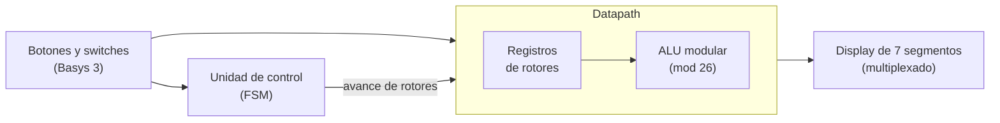

<div align="center">

# FPGA Enigma Machine
### Implementación hardware en VHDL sobre Artix-7


<br>

**Recuperando la ingeniería de los años 40 mediante lógica digital moderna.**
Este proyecto no es una simple simulación: es una reconstrucción de los rotores y circuitos de la Enigma, traducidos a puertas lógicas para operar en tiempo real.

<p align="center">
  <a href="#descripción-del-proyecto"></a>
  <a href="#arquitectura-del-sistema"></a>
  <a href="#manual-de-operación"></a>
  <a href="#autores"></a>
</p>

<br>


<br>
<em>Figura 1: Diseño conceptual del flujo de datos (Datapath).</em>

</div>

---

## Descripción del proyecto

El objetivo fue replicar la **máquina Enigma** utilizando hardware reconfigurable. En lugar de escribir código que se ejecuta secuencialmente (como en C o Python), hemos diseñado un circuito digital que **existe físicamente** dentro de la FPGA.

El diseño se separa estrictamente en dos bloques: el **Datapath**, que transporta y transforma las letras, y la **lógica de control**, que decide cuándo y cómo ocurren las operaciones.

### Características principales

<table>
  <tr>
    <td width="50%" valign="top">
      <br>
      <b>Mecánica virtual</b><br>
      El "clic" físico de los rotores y el trinquete se recrea mediante contadores y lógica de estado.
    </td>
    <td width="50%" valign="top">
      <br>
      <b>Aritmética modular</b><br>
      El cifrado se calcula con aritmética modular (<code>MOD 26</code>) implementada directamente en hardware, sin procesador.
    </td>
  </tr>
  <tr>
    <td width="50%" valign="top">
      <br>
      <b>Fiabilidad</b><br>
      Sistema de <i>debouncing</i> de 50 ms para que la respuesta de los botones de la placa sea firme y precisa.
    </td>
    <td width="50%" valign="top">
      <br>
      <b>Visualización</b><br>
      Salida multiplexada en displays de 7 segmentos.
    </td>
  </tr>
</table>

### Ficha técnica

| Parámetro | Valor |
| :--- | :--- |
| Plataforma | Digilent Basys 3 (Xilinx Artix-7) |
| Lenguaje | VHDL |
| Herramienta de síntesis | Vivado |
| Aritmética | Modular (`MOD 26`), combinacional |
| Antirrebote | 50 ms |
| Salida | Display de 7 segmentos multiplexado |

---

## Arquitectura del sistema

Todo el diseño se ha sintetizado y probado en una placa **Basys 3 (Artix-7)**. El siguiente diagrama simplificado resume la relación entre bloques; los esquemas RTL reales se muestran en cada apartado.



### 1. Jerarquía Top-Level

Módulo que conecta todo el sistema. Une los periféricos (botones, switches) con la lógica interna, actuando como la placa base del diseño.


### 2. Unidad de control

Esta máquina de estados finitos (FSM) orquesta todo el proceso: detecta la pulsación, espera a que la señal se estabilice y ordena a los rotores que giren.

> Como todo buen diseño, este nació en papel. A continuación se muestra el boceto original de los estados y su traducción final a hardware.

<div align="center">
  
  
</div>

### 3. ALU modular

Este módulo constituye el núcleo de ejecución del sistema. Su función principal es emular el cableado físico de los rotores originales mediante aritmética modular, aplicando operaciones de suma y resta de offsets para transformar la señal de entrada.

```text
Salida = (Entrada + Offset_Rotor) mod 26
```

La implementación se basa en un diseño combinacional que garantiza que la sustitución de caracteres sea instantánea una vez que los registros de los rotores están estables.


---

## Manual de operación

A continuación se muestra el mapa de interfaz de la placa.

> [!IMPORTANT]
> Es recomendable realizar un **RESET** al encender la FPGA.

> [!NOTE]
> La figura es una guía visual para la configuración física en la Basys 3.

<div align="center">
    
</div>

### Tabla de referencia rápida

| Componente | Función | Detalles |
| :--- | :--- | :--- |
| **A. Displays** | Visualización | **[ Rotores \| Entrada \| Salida ]** |
| **B. Botones** | Control | `Centro`: reset total / `Derecho`: cifrar letra |
| **C. Switches [0-4]** | Entrada de datos | Selección de letra en binario (ver tabla inferior). |
| **D. Switches [13-14]** | Configuración de rotores | Selección de rodillo/tabla interna. |
| **E. Switch [15]** | Modo | Posición baja: cifrar / posición alta: descifrar |

<details>
<summary><strong>Tabla de códigos binarios (A-Z)</strong></summary>
<br>

| Letra | Binario | Letra | Binario | Letra | Binario |
| :---: | :---: | :---: | :---: | :---: | :---: |
| **A** | 00000 | **J** | 01001 | **S** | 10010 |
| **B** | 00001 | **K** | 01010 | **T** | 10011 |
| **C** | 00010 | **L** | 01011 | **U** | 10100 |
| **D** | 00011 | **M** | 01100 | **V** | 10101 |
| **E** | 00100 | **N** | 01101 | **W** | 10110 |
| **F** | 00101 | **O** | 01110 | **X** | 10111 |
| **G** | 00110 | **P** | 01111 | **Y** | 11000 |
| **H** | 00111 | **Q** | 10000 | **Z** | 11001 |
| **I** | 01000 | **R** | 10001 | | |

</details>

---

## Autores

Proyecto desarrollado para la asignatura de [**Tecnología de Computadores**](https://www.ucm.es/estudios/grado-ingenieriadecomputadores-plan-803217) de la [**UCM**](https://www.ucm.es/). Curso 2025-26.

<div align="center">

| [<br /><sub><b>Juan Pastrana García</b></sub>](https://github.com/GustoffotsuG) | [<br /><sub><b>Omar Ouahri Vigil</b></sub>](https://github.com/theomaaroo) |
| :---: | :---: |

</div>
